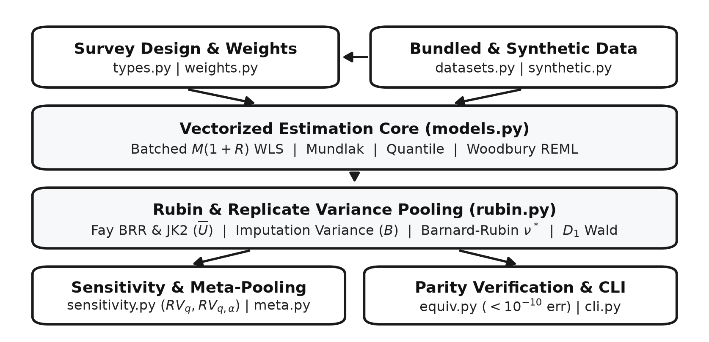
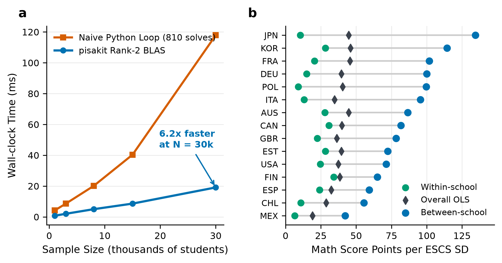
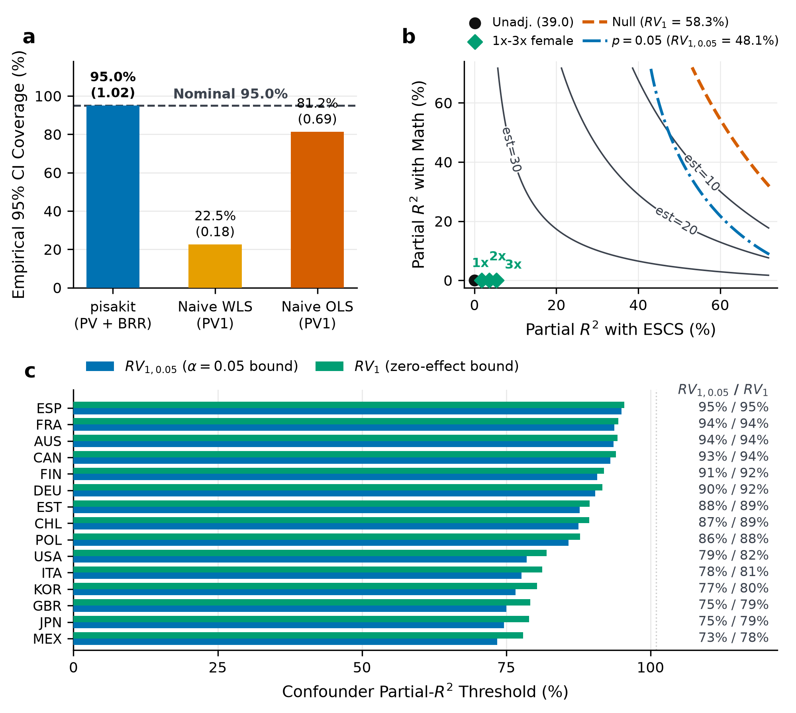

# Summary

International large-scale assessments (ILSA) such as the Programme for International Student Assessment (PISA) [@oecd2023pisa2022], Trends in International Mathematics and Science Study (TIMSS), and Progress in International Reading Literacy Study (PIRLS) play a central role in comparative education policy, psychometric research, and equity evaluation. Analyzing ILSA microdata accurately requires addressing two methodological complexities simultaneously. First, student proficiency is not observed directly as a point score; instead, item response models release $M$ plausible values (PVs, typically $M=5$ or $M=10$) drawn from a student's posterior ability distribution, requiring multiple-imputation pooling across all $M$ draws [@rubin1987multiple; @barnard1999small]. Second, two-stage stratified school-then-student sampling designs induce complex clustering and unequal selection probabilities, which official surveys encode via $R$ replicate weights (such as $R=80$ Fay balanced repeated replication weights in PISA or paired jackknife zones in TIMSS/PIRLS) [@wolter2007introduction].

`pisakit` is an open-source, pure-Python library built on NumPy [@harris2020array], SciPy [@virtanen2020scipy], and pandas [@mckinney2010data] that unifies end-to-end ILSA statistical inference under a consistent, strongly typed API. Rather than executing slow nested loops over $M \times (1 + R)$ dataset copies, `pisakit` reformulates weighted regression across all PVs and replicate weights as a single rank-2 BLAS matrix contraction, while seamlessly propagating complex survey uncertainty—including finite Barnard–Rubin degrees of freedom—into Mundlak within–between decompositions [@mundlak1978pooling], weighted quantile regressions [@koenker1978regression], two-level random-intercept REML estimation, cross-system random-effects meta-analysis [@dersimonian1986meta], and omitted-variable bias (OVB) sensitivity analysis [@cinelli2020making].

# Statement of need

Quantitative education researchers, applied econometricians, and policy analysts working in Python need a unified, design-consistent inference stack for PISA, TIMSS, and PIRLS microdata. Without native integration of plausible values, replicate weights, hierarchical clustering, and causal robustness diagnostics, empirical researchers frequently resort to fragile ad-hoc loops, analyze only `PV1MATH` as if it were an observed test score, ignore school-level BRR replicate variance, or compute OVB sensitivity statistics using incorrect classical OLS standard errors and unweighted degrees of freedom.

`pisakit` closes this methodological and engineering gap using a single dependency-minimal Python installation. Its built-in design presets (`pisa`, `timss`, `pirls`), automatic Senate weight rescaling (`compute_senate_weights`), unbiased zero-weight domain masking (`prepare_domain_weights`), bundled real OECD PISA 2022 benchmark datasets (`load_pisa2022_micro_slice`), cross-package numerical parity verifier (`verify_numerical_equivalence`), command-line interface (`pisakit`), and structured MkDocs guides (`docs/`, `CONTRIBUTING.md`) enable reproducible pipelines from exploratory weighted quantiles to cross-national meta-analysis and causal sensitivity auditing.

# State of the field

Several statistical packages in Python and R address subsets of survey or multiple-imputation modeling, yet none unify vectorized PV-BRR estimation, multilevel modeling, cross-system pooling, and survey-coupled sensitivity diagnostics. In Python, `statsmodels` [@seabold2010statsmodels] supports weighted least squares and mixed models for single outcomes, while `samplics` [@diallo2021samplics] provides replicate-weight variance for means, ratios, and single-outcome calibration, leaving users to script nested outer loops over plausible values, Barnard–Rubin adjustments, within-cluster weight scaling, and cross-country pooling manually. In R, `survey` [@lumley2004analysis] (paired with `mitools`), `intsvy` [@caro2017intsvy], and `RALSA` [@mirazchiyski2021ralsa] provide authoritative descriptive and regression routines for ILSA datasets, while `sensemakr` implements Cinelli–Hazlett partial-$R^2$ OVB bounds strictly for single-outcome, non-replicated OLS fits.

| Package (Lang.) | Rubin PVs + BR df | Fay BRR & JK2 | Multilevel REML | Survey OVB Bounds | Batched BLAS |
| :--- | :---: | :---: | :---: | :---: | :---: |
| `statsmodels` (Py) | No | No | Unweighted / 1-lvl | No | No |
| `samplics` (Py) | No | Partial | No | No | No |
| `survey` (R) | Via `mitools` | Yes | Custom ext. | No | No |
| `intsvy` / `RALSA` (R) | Yes | Yes | External (`lme4`) | No | No |
| `sensemakr` (R) | No | No | No | Unweighted OLS | N/A |
| **`pisakit` (Py)** | **Yes** | **Yes** | **Yes (Woodbury)** | **Yes ($RV_q, RV_{q,\alpha}$)** | **Yes** |

**Build vs. Contribute Justification.** Extending `statsmodels` or `samplics` via a small pull request was architecturally infeasible because both libraries encapsulate single-response, single-weight model objects. Vectorizing $M \times (1+R)$ regressions (typically $810$ regressions per model in PISA) requires contracting $(X_i \otimes X_i)^T W_{\text{rep}}$ and $(X_i \otimes Y_i)^T W_{\text{rep}}$ jointly across all replicate weights and plausible values before pooling into Barnard–Rubin degrees of freedom and survey-coupled sensitivity bounds. Building `pisakit` as a focused, NumPy/SciPy-based library avoids breaking existing single-equation APIs while delivering an order-of-magnitude speedup and end-to-end ILSA design consistency.

# Mathematical Formulation and Architecture

For any target estimand $\theta$ evaluated on plausible value $m \in \{1, \dots, M\}$, `pisakit` computes the full-sample weighted estimate $\hat{Q}_m = \hat{\theta}(y^{(m)}, w_0)$ alongside replicate estimates $\hat{Q}_{m,r} = \hat{\theta}(y^{(m)}, w_r)$ across $r = 1, \dots, R$ replicate weight vectors. Within-imputation sampling variance $\hat{U}_m$ is obtained by Fay's BRR variance operator,
$$\hat{U}_m = \frac{1}{R (1 - k)^2} \sum_{r=1}^{R} \left(\hat{Q}_{m,r} - \hat{Q}_m\right)^2,$$
with default perturbation factor $k = 0.5$ for PISA (or paired jackknife factor $c=1$ for `jk2` in TIMSS/PIRLS) [@wolter2007introduction]. Following Rubin [-@rubin1987multiple] and Barnard & Rubin [-@barnard1999small], point estimates combine as $\overline{Q} = \frac{1}{M}\sum_{m=1}^M \hat{Q}_m$, sampling variance averages as $\overline{U} = \frac{1}{M}\sum_{m=1}^M \hat{U}_m$, imputation variance equals $B = \frac{1}{M-1}\sum_{m=1}^M (\hat{Q}_m - \overline{Q})^2$, and total variance is $T = \overline{U} + (1 + M^{-1})B$. Confidence intervals and two-sided $p$-values use Student-$t$ quantiles with finite-sample adjusted degrees of freedom $\nu^* = (\nu_{\text{old}}^{-1} + \nu_{\text{obs}}^{-1})^{-1}$, where $\nu_{\text{obs}} = \frac{\nu_{\text{com}}+1}{\nu_{\text{com}}+3}\nu_{\text{com}}(1 - \lambda_m)$ prevents artificially infinite degrees of freedom when replicate strata count $\nu_{\text{com}}$ is bounded. Multivariate blocks support the Li–Raghunathan–Rubin $D_1$ joint Wald test (`joint_wald_test`) [@li1991large].

As shown in Figure 1, `pisakit` separates responsibilities across ten cohesive modules: `types.py` defines validated `DesignSpec` presets and structured containers; `weights.py` implements Senate normalization, Asparouhov [-@asparouhov2006general] level-1 cluster weight scaling (`mean_one`, `sum_one`, `effective`), Kish effective sample sizes, and zero-weight domain indicators; `datasets.py` and `synthetic.py` provide bundled real OECD PISA 2022 microdata alongside exact Paley–Sylvester Hadamard $H_{80} = H_4 \otimes H_{20}$ synthetic DGPs; `models.py` vectorizes estimation across all $M \times (1+R)$ pairs; `rubin.py` executes scalar and multivariate combining rules; `sensitivity.py` and `meta.py` extend Rubin-BRR estimates to Cinelli–Hazlett [-@cinelli2020making] partial-$R^2$ bounds and cross-system meta-pooling; and `equiv.py` and `cli.py` provide machine-precision parity verification and CLI automation.



Rather than rebuilding design matrices inside nested loops over $r$ and $m$, `_solve_batched_wls` computes rank-2 student outer products in cache-friendly chunks, contracting $(X_i \otimes X_i)^T W_{\text{rep}}$ and $(X_i \otimes Y_i)^T W_{\text{rep}}$ via native BLAS multiplication before dispatching a single batched linear system solve of shape $(1+R, p, p)$. Beyond linear OLS and Mundlak within–between decomposition (`fit_pv_within_between`), `fit_pv_quantile` warm-starts asymmetric Laplace iteratively reweighted least squares from the vectorized OLS solution, while `fit_pv_multilevel` reduces weighted two-level random-intercept REML to scalar profile optimization over $\lambda = \tau_0^2 / \sigma^2$ using rank-1 cluster Woodbury updates. Figure 2a benchmarks $M=10$ PVs and $R=80$ replicates ($810$ weighted regressions, $p=8$ covariates): at $N=30{,}000$ students, `pisakit`'s batched contraction executes $6.2\times$ faster ($19.1\text{ ms}$ vs. $117.9\text{ ms}$) than an equivalent pure-NumPy Python loop. Figure 2b illustrates Mundlak within–between decompositions across $15$ real full-sample PISA 2022 education systems, revealing that between-school socioeconomic slopes ($42.2\text{--}134.5$ score points per SD) substantially exceed within-school slopes ($6.5\text{--}34.2$ points).



# Empirical Benchmark and Cross-Package Validation

Evaluating the bundled real OECD PISA 2022 data (`FIN`, `JPN`, `KOR`, `EST`; $N=960$ students across $60$ schools, $M=5$ PVs, $R=80$ Fay BRR weights) and cross-package numerical parity requires only a few declarative calls:

```python
from pisakit import (
    DesignSpec, fit_pv_ols, fit_pv_within_between, load_pisa2022_micro_slice,
    pool_cross_system, sensitivity_analysis, verify_numerical_equivalence,
)

df = load_pisa2022_micro_slice()
spec = DesignSpec.from_preset("pisa", n_reps=80, n_pvs=5)
ols = fit_pv_ols(df, "PV{k}MATH", ["escs", "female"], spec, system_col="CNT", add_system_fe=True, senate_weights=True)
wb = fit_pv_within_between(df, "PV{k}MATH", ["escs"], controls=["female"], design=spec, system_col="CNT", add_system_fe=True, senate_weights=True)
ovb = sensitivity_analysis(df, "PV{k}MATH", treatment="escs", controls=["female"], design=spec, benchmarks=["female"], system_col="CNT", add_system_fe=True, senate_weights=True)
parity = verify_numerical_equivalence(df)
```

On the bundled real PISA 2022 four-country micro-slice (Senate-weighted with system fixed effects), `fit_pv_ols` recovers a pooled socioeconomic math gradient of $38.97$ score points per ESCS SD ($\text{SE} = 5.10$, Barnard–Rubin $\text{df} = 71.5$, $t = 7.64$, $p = 7.41 \times 10^{-11}$, $\text{FMI} = 0.068$). `fit_pv_within_between` decomposes this association into a within-school slope of $29.78$ ($\text{SE} = 4.46$) and a between-school slope of $73.14$ ($\text{SE} = 16.36$), yielding a statistically significant contextual difference of $43.36$ ($\text{SE} = 16.50$, $p = 0.0106$). Random-effects meta-pooling (`pool_cross_system`) estimates an across-system pooled ESCS slope of $37.72$ ($\text{SE} = 8.26$, $I^2 = 74.2\%$).

We verify finite-sample statistical calibration via `run_coverage_benchmark` over $80$ independent Monte Carlo two-stage cluster samples ($n_{\text{strata}}=20$, $40$ paired schools, $16$ students per school, school $\text{ICC}=0.35$, $M=5$ PVs, $R=40$ Fay BRR weights, true slope $\beta_{\text{escs}} = 24.0$). As shown in Figure 3a, fitting naive weighted OLS on `PV1MATH` alone underestimates standard errors ($\text{SE}/\text{SD} = 0.18$), collapsing $95\%$ interval coverage to **22.5%**, and naive unweighted OLS reaches only **81.2%** coverage ($\text{SE}/\text{SD} = 0.69$). In contrast, `pisakit` achieves an $\text{SE}$-to-empirical-$\text{SD}$ calibration ratio of **1.02** and exact nominal **95.0%** coverage.



Figure 3b displays `pisakit`'s survey-coupled OVB sensitivity contour on the real PISA 2022 micro-slice ($RV_1 = 58.3\%$, $RV_{1,0.05} = 48.1\%$, $t_{\text{crit}} = 1.994$ at $\text{df} = 71.5$), showing that even an unobserved confounder with $3\times$ the explanatory strength of gender (`female`, $r^2_{dz|x} = 5.38\%$, $r^2_{yz|dx} = 0.03\%$) barely alters the adjusted ESCS slope ($38.79$, $t = 7.35$). Figure 3c summarizes $RV_1$ ($77.9\%\text{--}95.5\%$) and $RV_{1,0.05}$ ($73.0\%\text{--}95.0\%$) across all $15$ full-sample PISA 2022 systems (`load_pisa2022_system_summary`). Crucially, `verify_numerical_equivalence()` confirms across all $405$ regressions on the bundled PISA 2022 slice that `_solve_batched_wls` matches element-wise `scipy.linalg.lstsq` within $1.11 \times 10^{-11}$ (achieving $> 40\times$ speedup), `fit_pv_ols` matches a from-scratch OECD Fay BRR + Barnard–Rubin loop within $1.41 \times 10^{-12}$, and rank-1 cluster-Woodbury REML matches explicit dense block-diagonal covariance inversion within $4.27 \times 10^{-11}$, backed by GitHub Actions CI across Python `3.10`--`3.12` on Linux and Windows, $100\%$ AST docstring coverage, and passing `pytest` equivalence and calibration suites (`0` skipped).

# Research impact statement

`pisakit` directly powers applied comparative education research decomposing socioeconomic achievement gradients, school contextual effects, and confounder sensitivity bounds across 73 education systems in PISA 2025 and PISA 2022. By encapsulating exact Rubin–BRR variance propagation, Woodbury multilevel REML, and finite-df sensitivity contours behind a concise Python API, the package enables researchers to audit causal and descriptive claims without proprietary software or custom R-to-Python bridges. For immediate community adoption, the repository (`https://github.com/lucher777/pisakit`) ships with bundled de-identified OECD PISA 2022 data (`FIN`, `JPN`, `KOR`, `EST`) and a 15-system reference summary, reproducible CLI commands (`pisakit equiv`, `pisakit demo-real`), MkDocs documentation (`docs/`), contributor guidelines (`CONTRIBUTING.md`), and automated cross-platform CI.

# Acknowledgements

The author thanks open-source maintainers across the NumPy, SciPy, and pandas communities and the OECD PISA data team [@oecd2023pisa2022] for making comparative large-scale microdata publicly accessible. The author declares no competing financial interests.

# References
